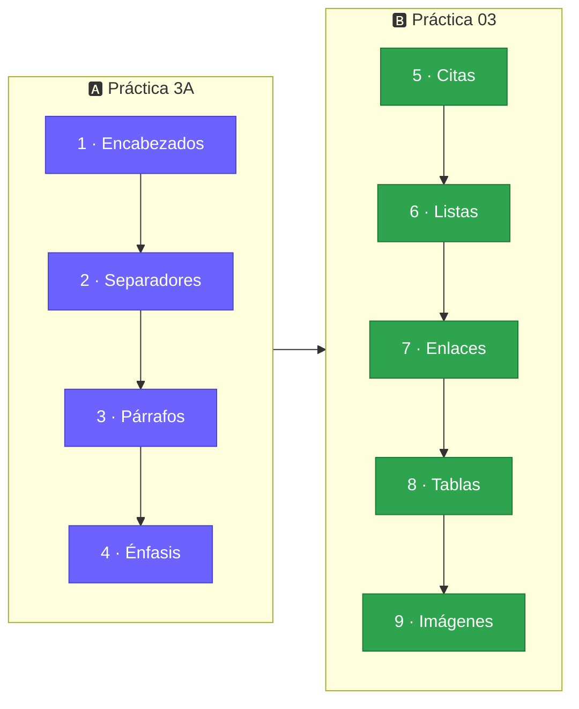
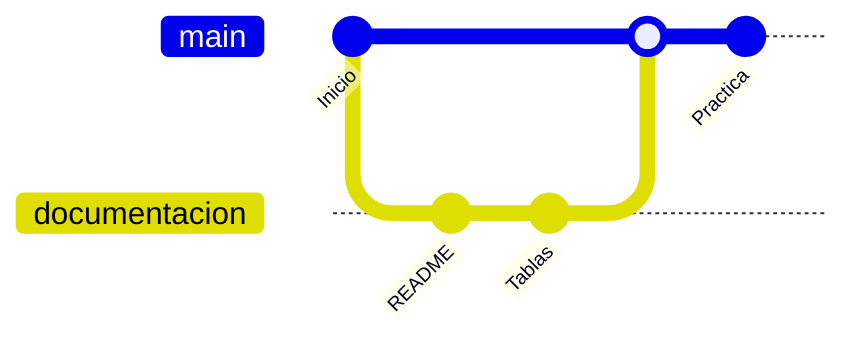

<!--
  README DEL REPOSITORIO · Integradora-Practica-3A
  ---------------------------------------------------------
  Solo necesitas hacer UN cambio: busca la palabra USUARIO y reemplázala
  por tu usuario de GitHub (aparece en las insignias del repositorio y en
  el comando git clone). Todo lo demás ya está listo.
-->

<a id="inicio"></a>

<div align="center">


<br>


<br>

<table>
  <tr>
    <td align="center" width="170"><h2>9</h2><sub><b>TEMAS</b></sub></td>
    <td align="center" width="170"><h2>2</h2><sub><b>PRÁCTICAS</b></sub></td>
    <td align="center" width="170"><h2>6</h2><sub><b>NIVELES DE ENCABEZADO</b></sub></td>
    <td align="center" width="170"><h2>4</h2><sub><b>ESTILOS DE ÉNFASIS</b></sub></td>
  </tr>
</table>

</div>

<br>

## 🎯 Acerca de la práctica

En esta práctica aprenderemos a utilizar las herramientas de **Git** y **GitHub** para el **control de versiones**, la **documentación**, el **desarrollo colaborativo** y el **respaldo** del Proyecto Integrador de la asignatura **Integradora I**.

> [!NOTE]
> **Markdown** es el estándar utilizado por Git y GitHub para maquetar la documentación de los proyectos. Gracias a él, usuarios y colaboradores pueden entender fácilmente el contexto y la operación del proyecto.

## 🗺️ Ruta de aprendizaje



## 📚 Contenido

<div align="center">

<table>
  <tr>
    <td align="center" width="260"><h3>📑<br><a href="#encabezados">Encabezados</a></h3><sub>Jerarquía de títulos<br>del H1 al H6</sub></td>
    <td align="center" width="260"><h3>➖<br><a href="#separadores">Separadores</a></h3><sub>Divisiones visuales<br>entre secciones</sub></td>
    <td align="center" width="260"><h3>📝<br><a href="#parrafos">Párrafos</a></h3><sub>Bloques de texto<br>y alineación</sub></td>
  </tr>
  <tr>
    <td align="center" width="260"><h3>✨<br><a href="#enfasis">Énfasis</a></h3><sub>Negrita, cursiva<br>y subrayado</sub></td>
    <td align="center" width="260"><h3>💬<br><a href="#citas">Citas y bloques</a></h3><sub>Resalta instrucciones<br>y código</sub></td>
    <td align="center" width="260"><h3>📋<br><a href="#listas">Listas</a></h3><sub>Ordenadas y<br>con viñetas</sub></td>
  </tr>
  <tr>
    <td align="center" width="260"><h3>🔗<br><a href="#enlaces">Enlaces</a></h3><sub>Hipervínculos<br>y correos</sub></td>
    <td align="center" width="260"><h3>📊<br><a href="#tablas">Tablas</a></h3><sub>Filas, columnas y<br>celdas fusionadas</sub></td>
    <td align="center" width="260"><h3>🖼️<br><a href="#imagenes">Imágenes</a></h3><sub>Texto alternativo<br>y vínculos</sub></td>
  </tr>
</table>

<sub>⚡ Atajos: <a href="#referencia">Hoja de referencia</a> · <a href="#errores">Errores comunes</a> · <a href="#flujo">Flujo de trabajo con Git</a></sub>

</div>

<br>

---

<h1 align="center">🅰️ Práctica 3A</h1>
<p align="center"><i>Encabezados · Separadores · Párrafos · Énfasis</i></p>

---

<a id="encabezados"></a>
<h2>📑 1 · Encabezados o Títulos <sub>(Headers)</sub></h2>

Para realizar una buena documentación debemos distribuir correctamente el contenido y **resaltar las secciones importantes**. Los encabezados se crean con el símbolo `#`: a más símbolos, menor jerarquía.

<table>
<tr>
<td width="50%" valign="top">

**✍️ Sintaxis**

```markdown
# Encabezado de Nivel 1
## Encabezado de Nivel 2
### Encabezado de Nivel 3
#### Encabezado de Nivel 4
##### Encabezado de Nivel 5
###### Encabezado de Nivel 6
```

</td>
<td width="50%" valign="top">

**👀 Equivalencia**

| Nivel | Símbolo | En HTML |
|:-----:|:-------:|:-------:|
| 1 | `#` | `<h1>` |
| 2 | `##` | `<h2>` |
| 3 | `###` | `<h3>` |
| 4 | `####` | `<h4>` |
| 5 | `#####` | `<h5>` |
| 6 | `######` | `<h6>` |

</td>
</tr>
</table>

> [!WARNING]
> Solo se permiten **6 niveles** dentro de la sintaxis. A partir de `#######` (7 símbolos) el maquetado será ignorado.

<p align="right"><a href="#inicio">⬆️ Volver arriba</a></p>

---

<a id="separadores"></a>
<h2>➖ 2 · Separadores <sub>(Separators)</sub></h2>

Si se desea marcar una separación más visual entre contenidos, se escriben **tres guiones continuos**. Es similar a la etiqueta `<hr>` de HTML.

<table>
<tr>
<td width="50%" valign="top">

**✍️ Sintaxis**

```markdown
---
```

</td>
<td width="50%" valign="top">

**👀 Resultado**

---

</td>
</tr>
</table>

<p align="right"><a href="#inicio">⬆️ Volver arriba</a></p>

---

<a id="parrafos"></a>
<h2>📝 3 · Párrafos <sub>(Paragraphs)</sub></h2>

Se utilizan para presentar grandes secciones de texto que describen de forma detallada las partes de la documentación. En Markdown basta con dejar una **línea en blanco** entre un párrafo y otro; también se puede usar la etiqueta HTML `<p>`.

```markdown
Este texto pertenece al párrafo 1.

<p>
Este texto pertenece al párrafo 2.
</p>
```

### Alineación de párrafos

También podemos aplicar estilos de alineación con el atributo `align`:

```html
<p align="left">Texto alineado a la izquierda</p>
<p align="center">Texto centrado</p>
<p align="right">Texto alineado a la derecha</p>
<p align="justify">Texto justificado</p>
```

<table>
<tr>
<td width="50%" align="left"><b>⬅️ Izquierda</b><br>Este texto pertenece al párrafo 1. Este texto pertenece al párrafo 1. Este texto pertenece al párrafo 1. Este texto pertenece al párrafo 1.</td>
<td width="50%" align="center"><b>↔️ Centrado</b><br>Este texto pertenece al párrafo 2. Este texto pertenece al párrafo 2. Este texto pertenece al párrafo 2. Este texto pertenece al párrafo 2.</td>
</tr>
<tr>
<td width="50%" align="right"><b>➡️ Derecha</b><br>Este texto pertenece al párrafo 3. Este texto pertenece al párrafo 3. Este texto pertenece al párrafo 3. Este texto pertenece al párrafo 3.</td>
<td width="50%" align="justify"><b>📰 Justificado</b><br>Este texto pertenece al párrafo 4. Este texto pertenece al párrafo 4. Este texto pertenece al párrafo 4. Este texto pertenece al párrafo 4.</td>
</tr>
</table>

<p align="right"><a href="#inicio">⬆️ Volver arriba</a></p>

---

<a id="enfasis"></a>
<h2>✨ 4 · Texto enfatizado <sub>(Bold, Italic, Bold/Italic)</sub></h2>

Si el texto que deseamos enfatizar se encuentra dentro de un párrafo, podemos utilizar estos recursos:

| Estilo | Sintaxis | Resultado |
|:-------|:---------|:----------|
| 🔹 Cursiva (*italic*) | `*texto*` o `_texto_` | *texto* |
| 🔸 Negrita (**bold**) | `**texto**` o `__texto__` | **texto** |
| 💎 Negrita y cursiva (***bold/italic***) | `***texto***` | ***texto*** |
| ➖ Tachado | `~~texto~~` | ~~texto~~ |
| 📏 Subrayado | `<ins>texto</ins>` | <ins>texto</ins> |

> [!TIP]
> Markdown **no tiene** un atajo para subrayar, por eso se utiliza la etiqueta estándar de HTML `<ins>texto</ins>`.

**Ejemplo en contexto:**

Texto texto texto **negrita** texto texto *cursiva* texto texto ***negrita y cursiva*** texto texto <ins>subrayado</ins> texto texto texto.

<p align="right"><a href="#inicio">⬆️ Volver arriba</a></p>

---

<h1 align="center">🅱️ Práctica 03</h1>
<p align="center"><i>Citas · Listas · Enlaces · Tablas · Imágenes</i></p>

Continuamos con los comandos básicos de Git y GitHub para el maquetado de la documentación.

---

<a id="citas"></a>
<h2>💬 5 · Cuadros para códigos o reseñas <sub>(Blockquotes)</sub></h2>

Se utilizan para resaltar instrucciones específicas de **instalación**, **configuración** o **inicialización**, o para mostrar secciones de código fuente. Se maquetan iniciando la línea con el símbolo de mayor que `>`.

<table>
<tr>
<td width="50%" valign="top">

**✍️ Sintaxis**

```markdown
> Aquí se ingresa un conjunto de
> instrucciones para explicar al
> usuario cómo instalar el software
> que hemos diseñado.
```

</td>
<td width="50%" valign="top">

**👀 Resultado**

> Aquí se ingresa un conjunto de instrucciones para explicar al usuario cómo instalar el software que hemos diseñado.

</td>
</tr>
</table>

También podemos incluir **viñetas** dentro de la cita para enlistar pasos:

> **🗄️ Pasos para instalar la base de datos**
>
> - Descargar MySQL Server del sitio oficial.
> - Instalar el Sistema Gestor de Bases de Datos, definiendo el puerto y la contraseña para el usuario `root`.
> - Descargar el archivo de respaldo de la base de datos (`.sql`).
> - Restaurar la base de datos con el comando `mysql`:
>   `"C:/Program Files/MySQL/MySQL Server 8.0/bin/mysql" -u root -p < respaldo.sql`

<details>
<summary>🎨 <b>Extra: alertas de colores de GitHub</b> (clic para ver)</summary>

<br>

```markdown
> [!NOTE]
> Información útil que el usuario debería conocer.

> [!TIP]
> Consejo para hacer las cosas mejor.

> [!IMPORTANT]
> Información clave para lograr el objetivo.

> [!WARNING]
> Contenido que requiere atención inmediata.

> [!CAUTION]
> Advierte sobre posibles riesgos o consecuencias negativas.
```

> [!NOTE]
> Información útil que el usuario debería conocer.

> [!TIP]
> Consejo para hacer las cosas mejor.

> [!IMPORTANT]
> Información clave para lograr el objetivo.

> [!WARNING]
> Contenido que requiere atención inmediata.

> [!CAUTION]
> Advierte sobre posibles riesgos o consecuencias negativas.

</details>

<p align="right"><a href="#inicio">⬆️ Volver arriba</a></p>

---

<a id="listas"></a>
<h2>📋 6 · Listas ordenadas y desordenadas</h2>

Si necesitamos presentar información como una lista, un elemento tras otro, usamos **números con punto** para listas ordenadas y un **guion medio** `-` para listas con viñetas.

<table>
<tr>
<td width="50%" valign="top">

**✍️ Sintaxis**

```markdown
1. Primer paso
2. Segundo paso
   - Sub-elemento A
   - Sub-elemento B
3. Tercer paso
```

</td>
<td width="50%" valign="top">

**👀 Resultado**

1. Primer paso
2. Segundo paso
   - Sub-elemento A
   - Sub-elemento B
3. Tercer paso

</td>
</tr>
</table>

**Ejemplo real:** para crear tu primer repositorio en GitHub deberás:

1. Contar con una cuenta de GitHub.
2. Dar clic en el botón **Nuevo repositorio**.
3. Asignarle un nombre a tu repositorio, por ejemplo: `practica03-3b`.
4. Asignarle un nivel de privacidad:
   - **Público:** si quieres que esté disponible para todos los usuarios.
   - **Privado:** si deseas que solo quienes tú decidas puedan ver y colaborar en tu proyecto.
5. Definir si incluirá un archivo de descripción llamado `README.md`.
6. Definir si habrá exclusiones de archivos a través del archivo `.gitignore`.
7. Guardar los cambios.

<p align="right"><a href="#inicio">⬆️ Volver arriba</a></p>

---

<a id="enlaces"></a>
<h2>🔗 7 · Ligas <sub>(Hipervínculos)</sub></h2>

Las ligas vinculan elementos o referencias del proyecto, dentro o fuera del repositorio. Se maquetan con corchetes `[]` para el texto, seguidos inmediatamente de la dirección entre paréntesis `()`.

<table>
<tr>
<td width="50%" valign="top">

**✍️ Sintaxis**

```markdown
[Google](https://www.google.com/)

<https://github.com/>

<230317@utxicotepec.edu.mx>
```

</td>
<td width="50%" valign="top">

**👀 Resultado**

[Google](https://www.google.com/)

<https://github.com/>

<230317@utxicotepec.edu.mx>

</td>
</tr>
</table>

> [!TIP]
> Si deseas poner solo la liga directa o un correo electrónico, encierra la dirección entre los símbolos `< >`.

<p align="right"><a href="#inicio">⬆️ Volver arriba</a></p>

---

<a id="tablas"></a>
<h2>📊 8 · Tablas</h2>

Podemos presentar información en filas y columnas. Se usa el carácter `|` para delimitar las columnas y `-` para la línea del encabezado. Los dos puntos `:` controlan la alineación.

<table>
<tr>
<td width="50%" valign="top">

**✍️ Sintaxis**

```markdown
| Encabezado 1 | Encabezado 2 | Encabezado 3 |
|:-------------|:------------:|-------------:|
| Izquierda    |    Centro    |      Derecha |
| Fila 2 Celda 1 | Fila 2 Celda 2 | Fila 2 Celda 3 |
```

</td>
<td width="50%" valign="top">

**👀 Resultado**

| Encabezado 1 | Encabezado 2 | Encabezado 3 |
|:-------------|:------------:|-------------:|
| Izquierda | Centro | Derecha |
| Fila 2 Celda 1 | Fila 2 Celda 2 | Fila 2 Celda 3 |

</td>
</tr>
</table>

### 🧩 Fusión de celdas

> [!IMPORTANT]
> Con Markdown puro **no se pueden fusionar** celdas. Para lograrlo se usa el estándar HTML con las etiquetas `<table>`, `<tr>`, `<th>` y `<td>`, junto con las propiedades **`colspan`** (fusionar columnas) y **`rowspan`** (fusionar filas).

<details>
<summary>💻 <b>Ver el código HTML de la tabla</b></summary>

```html
<table>
  <tr>
    <th>Encabezado 1</th>
    <th>Encabezado 2</th>
    <th>Encabezado 3</th>
    <th>Encabezado 4</th>
  </tr>
  <tr>
    <td>Fila 1 Celda 1</td>
    <td>Fila 1 Celda 2</td>
    <td>Fila 1 Celda 3</td>
    <td>Fila 1 Celda 4</td>
  </tr>
  <tr>
    <td>Fila 2 Celda 1</td>
    <td colspan="3" align="center">Fila 2 Celda 2 (colspan=3)</td>
  </tr>
  <tr>
    <td rowspan="3">Fila 3 Celda 1 (rowspan=3)</td>
    <td>Fila 3 Celda 2</td>
    <td>Fila 3 Celda 3</td>
    <td>Fila 3 Celda 4</td>
  </tr>
  <tr>
    <td>Fila 4 Celda 2</td>
    <td>Fila 4 Celda 3</td>
    <td>Fila 4 Celda 4</td>
  </tr>
  <tr>
    <td>Fila 5 Celda 2</td>
    <td>Fila 5 Celda 3</td>
    <td>Fila 5 Celda 4</td>
  </tr>
  <tr>
    <td>Fila 6 Celda 1</td>
    <td>Fila 6 Celda 2</td>
    <td>Fila 6 Celda 3</td>
    <td>Fila 6 Celda 4</td>
  </tr>
</table>
```

</details>

<div align="center">

<table>
  <tr>
    <th>Encabezado 1</th>
    <th>Encabezado 2</th>
    <th>Encabezado 3</th>
    <th>Encabezado 4</th>
  </tr>
  <tr>
    <td>Fila 1 Celda 1</td>
    <td>Fila 1 Celda 2</td>
    <td>Fila 1 Celda 3</td>
    <td>Fila 1 Celda 4</td>
  </tr>
  <tr>
    <td>Fila 2 Celda 1</td>
    <td colspan="3" align="center">Fila 2 Celda 2 (colspan=3)</td>
  </tr>
  <tr>
    <td rowspan="3">Fila 3 Celda 1 (rowspan=3)</td>
    <td>Fila 3 Celda 2</td>
    <td>Fila 3 Celda 3</td>
    <td>Fila 3 Celda 4</td>
  </tr>
  <tr>
    <td>Fila 4 Celda 2</td>
    <td>Fila 4 Celda 3</td>
    <td>Fila 4 Celda 4</td>
  </tr>
  <tr>
    <td>Fila 5 Celda 2</td>
    <td>Fila 5 Celda 3</td>
    <td>Fila 5 Celda 4</td>
  </tr>
  <tr>
    <td>Fila 6 Celda 1</td>
    <td>Fila 6 Celda 2</td>
    <td>Fila 6 Celda 3</td>
    <td>Fila 6 Celda 4</td>
  </tr>
</table>

</div>

<p align="right"><a href="#inicio">⬆️ Volver arriba</a></p>

---

<a id="imagenes"></a>
<h2>🖼️ 9 · Imágenes</h2>

Se muestra una imagen escribiendo `!`, seguido del **texto alternativo** entre corchetes `[ ]` y, por último, el vínculo de la imagen entre paréntesis `()`. El texto alternativo es una descripción corta equivalente a la información de la imagen.

<table>
<tr>
<td width="50%" valign="top">

**✍️ Sintaxis**

```markdown

```

</td>
<td width="50%" valign="top" align="center">

**👀 Resultado**


</td>
</tr>
</table>

> [!NOTE]
> GitHub admite la inserción de imágenes en incidencias, solicitudes de incorporación de cambios (*pull requests*), debates, comentarios y archivos `.md`. Puedes mostrar una imagen desde tu repositorio, agregar un enlace a una imagen en línea o cargar una imagen directamente.

<p align="right"><a href="#inicio">⬆️ Volver arriba</a></p>

---

<a id="referencia"></a>
<h2>⚡ Hoja de referencia rápida</h2>

**Texto en línea**

| Elemento | Sintaxis | Resultado |
|:---------|:---------|:----------|
| Negrita | `**texto**` | **texto** |
| Cursiva | `*texto*` | *texto* |
| Negrita y cursiva | `***texto***` | ***texto*** |
| Tachado | `~~texto~~` | ~~texto~~ |
| Subrayado | `<ins>texto</ins>` | <ins>texto</ins> |
| Código en línea | `` `código` `` | `código` |
| Enlace | `[GitHub](https://github.com)` | [GitHub](https://github.com) |

**Bloques**

| Elemento | Sintaxis |
|:---------|:---------|
| Encabezado | `# Título` · `## Subtítulo` · `### Sección` |
| Separador | `---` |
| Cita | `> texto` |
| Lista con viñetas | `- elemento` |
| Lista numerada | `1. elemento` |
| Imagen | `` |
| Bloque de código | tres acentos graves, el lenguaje y tres acentos graves al cerrar |

---

<a id="errores"></a>
<h2>🚧 Errores comunes</h2>

| ❌ Incorrecto | ✅ Correcto | 💡 ¿Por qué? |
|:-------------|:-----------|:-------------|
| `*texto*` para negrita | `**texto**` | Un asterisco es cursiva; dos son negrita |
| `####### Título` | `###### Título` | Solo existen 6 niveles de encabezado |
| `/> texto` para citas | `> texto` | El símbolo de las citas es "mayor que" |
| `3.Asignar nombre` | `3. Asignar nombre` | Falta el espacio después del número |
| `colspan` en tabla Markdown | Tabla HTML con `<td colspan>` | Markdown puro no fusiona celdas |

---

<a id="flujo"></a>
<h2>🔄 Flujo de trabajo con Git</h2>

Así viaja tu documentación desde tu computadora hasta GitHub:



```bash
# 1. Clona el repositorio
git clone https://github.com/USUARIO/Integradora-Practica-3A.git

# 2. Guarda tus cambios
git add README.md
git commit -m "docs: mejora la documentación"

# 3. Súbelos a GitHub
git push origin main
```

<p align="right"><a href="#inicio">⬆️ Volver arriba</a></p>

---

<div align="center">

<h2>👩‍💻 Autora</h2>

Documentación creada por **_Jennifer Bautista Barrios_**

[](mailto:230317@utxicotepec.edu.mx)

<sub>Universidad Tecnológica de Xicotepec de Juárez · Integradora I</sub>

<br>

⭐ **Si te sirvió este repositorio, ¡déjale una estrella!** ⭐


</div>
