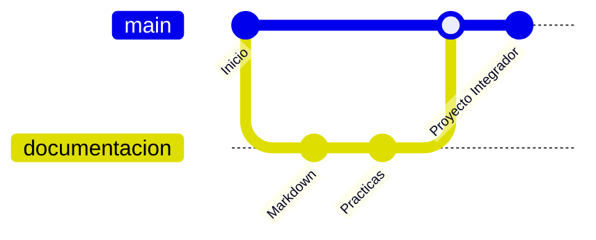

<!-- Reemplaza la palabra USUARIO por tu usuario de GitHub (busca y reemplaza todas) -->

<div align="center">


<h3>Hola, soy Jennifer 👋</h3>

<p>Estudiante de la Universidad Tecnológica de Xicotepec de Juárez,<br>en crecimiento y apasionada por aprender.</p>

[](https://github.com/USUARIO)
[](mailto:230317@utxicotepec.edu.mx)


</div>

---

<h2 align="center">Sobre mí</h2>

```text
$ whoami
Jennifer Bautista Barrios, estudiante de Integradora I

$ cat sobre-mi.txt
estudio:      Universidad Tecnológica de Xicotepec de Juárez
aprendo:      Git, GitHub, Markdown y MySQL
trabajo en:   Mi Proyecto Integrador
me interesa:  Colaborar y practicar el trabajo en equipo

$ _
```

---

<h2 align="center">Habilidades</h2>

<table>
  <tr>
    <td width="50%" valign="top">

**💻 Lo que uso**

<sub>Lenguajes y web</sub><br>


<sub>Control de versiones</sub><br>


<sub>Bases de datos</sub><br>


</td>
    <td width="50%" valign="top">

**🌱 Lo que estoy aprendiendo**

<sub>Lenguajes</sub><br>


<sub>Frameworks y plataformas</sub><br>


<sub>Editores y herramientas</sub><br>


</td>
  </tr>
</table>

<!--
  Más tecnologías para copiar y pegar en la categoría que quieras:
  
  
  
  
  
  
  
  
-->

---

<h2 align="center">Mi camino con Git</h2>



---

<h2 align="center">Mi actividad en GitHub</h2>

<div align="center">


<br>


<br>


</div>

---

<h2 align="center">Proyecto destacado</h2>

<div align="center">

<a href="https://github.com/USUARIO/Integradora-Practica-3A">
  
</a>

</div>

---

<h2 align="center">Redes sociales</h2>

<div align="center">

[](https://github.com/USUARIO)
[](mailto:230317@utxicotepec.edu.mx)

<!--
  Si tienes más redes, quita los comentarios y cambia TU_USUARIO:
  [](https://www.instagram.com/TU_USUARIO)
  [](https://www.facebook.com/TU_USUARIO)
  [](https://www.linkedin.com/in/TU_USUARIO)
-->

<br>

<h3><i>Aprender haciendo, documentando y compartiendo.</i></h3>


</div>
